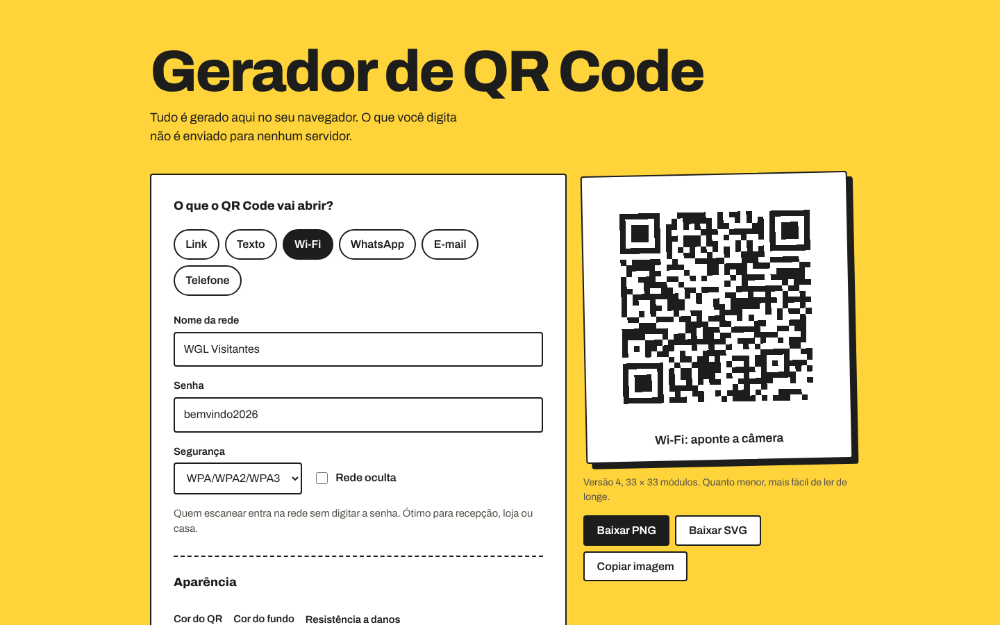
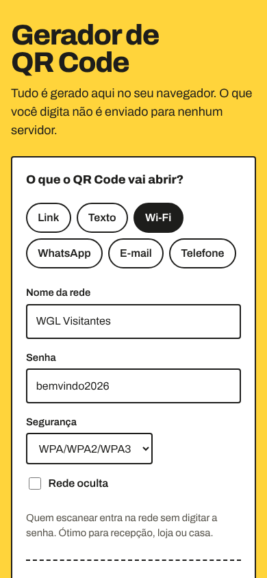
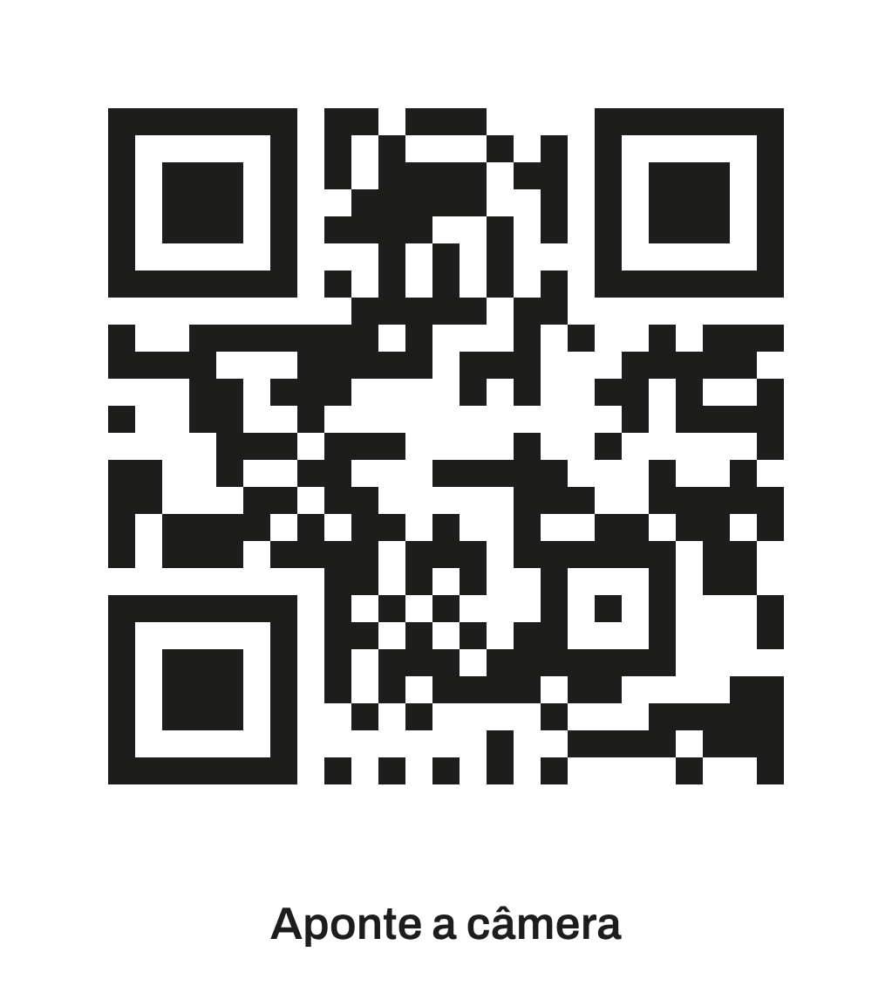

# Gerador de QR Code

[](https://github.com/wagnerglongo/gerador-de-QRCode/actions/workflows/test.yml)

Gerador de QR Code para link, texto, Wi-Fi, WhatsApp, e-mail e telefone. **Tudo roda no navegador:** o que a pessoa digita, inclusive a senha do Wi-Fi, não é enviado para nenhum servidor.

**🔗 No ar:** https://gerador-de-qr-code-one.vercel.app

<p align="center">
  
  
</p>

## Funcionalidades

- **Seis tipos de conteúdo**, cada um com o formato que os celulares entendem:
  - **Wi-Fi:** quem escaneia entra na rede sem digitar a senha (`WIFI:T:WPA;S:…;P:…;;`)
  - **WhatsApp:** abre a conversa com uma mensagem já escrita (`wa.me`)
  - **E-mail e telefone:** `mailto:` com assunto e corpo, `tel:` com DDI
  - **Link e texto** livre
- **Pré-visualização ao vivo** enquanto a pessoa digita, com validação e mensagens claras.
- **Cores personalizadas com alerta de leitura.** A ferramenta calcula o contraste (fórmula da WCAG) e avisa quando as cores podem falhar na câmera, inclusive no caso de QR claro sobre fundo escuro.
- **Resistência a danos** (níveis L, M, Q e H de correção de erro).
- **Cartão pronto para imprimir**, com legenda opcional, em **PNG** de alta resolução, **SVG** vetorial ou **copiado** direto para a área de transferência.

<p align="center"></p>

## Decisões técnicas

| Tema | O que foi feito |
|---|---|
| Privacidade | A versão anterior mandava o texto para uma API externa. Agora a codificação acontece localmente com a [uqr](https://github.com/unjs/uqr) (MIT, sem dependências), incluída em `src/vendor/`. |
| Arquitetura | `src/payloads.js` monta e valida o conteúdo de cada tipo; `src/render.js` desenha o SVG e calcula o contraste. As duas são funções puras, sem DOM. `src/main.js` cuida só da interface. |
| Correção dos formatos | Escape dos caracteres especiais do Wi-Fi (`\ ; , : "`), normalização de telefone brasileiro (adiciona o 55 só quando o DDI não foi informado), `%20` em vez de `+` no `mailto:` e bloqueio de protocolos como `javascript:` no tipo link. |
| SVG enxuto | Módulos vizinhos na mesma linha viram um único retângulo dentro de um só `<path>`, o que deixa o arquivo bem menor do que um `<rect>` por quadradinho. |
| Testes | 14 testes com `node --test`, rodando no GitHub Actions. Durante o desenvolvimento, cada tipo também foi conferido decodificando a imagem gerada com um leitor independente (OpenCV). |
| Acessibilidade | Tipos como botões de rádio nativos, campos com `label`, erros em `role="alert"`, avisos em `aria-live`. O rótulo do QR não expõe o conteúdo, para a senha do Wi-Fi não ser lida em voz alta. |

## Estrutura

```
├── index.html
├── src/
│   ├── payloads.js        # conteúdo de cada tipo + validação
│   ├── render.js          # SVG e contraste
│   ├── main.js            # interface e exportação
│   └── vendor/uqr.mjs     # codificador de QR (MIT)
├── tests/                 # node --test
├── assets/                # CSS e fontes
└── .github/workflows/test.yml
```

## Rodando localmente

```bash
git clone https://github.com/wagnerglongo/gerador-de-QRCode.git
cd gerador-de-QRCode
npm run dev    # http://localhost:3000
npm test       # Node 20+
```

---

Desenvolvido por [Wagner Longo](https://github.com/wagnerglongo).
